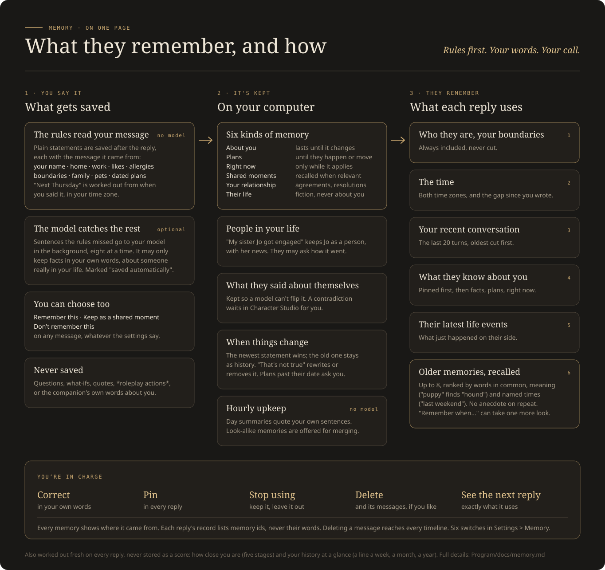
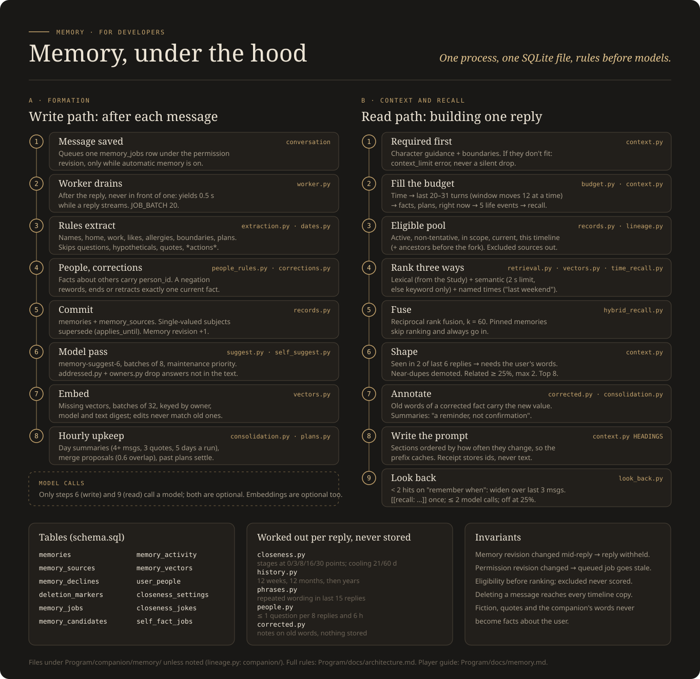

# Memory

Your companion remembers what you tell them, what you did together and what they said about themselves, and
they bring it up when it fits. All of it lives in one file on your computer, every memory shows where it came
from, and you can correct, pause or delete any of it.

This page has three parts: [what it remembers and what you control](#for-players), [how a reply finds the right
memories](#how-a-reply-is-built), and [the developer reference](#developer-reference). The short version for
developers: memory is saved by rules first, a model only fills gaps in your own words, and nothing in recall or
upkeep needs a model at all.

## For players

### What gets remembered

Memories are sorted into six kinds. You see them under the same headings in **Memories**.

| Heading in Memories | What goes there | How long it counts |
| --- | --- | --- |
| **About you** | Your name, home, work, likes and dislikes, favourites, allergies, boundaries, pets and family | Until you or a newer statement changes it |
| **Plans and commitments** | Things either of you said you'd do, with a date when one was given | Until it happens, is cancelled or moves |
| **Right now** | Passing circumstances: "I'm sick this week", "I'm at my parents' until Friday" | Only while they apply |
| **Shared moments** | Conversations and moments you had together | Recalled when they become relevant |
| **Your relationship** | Agreements, boundaries between you, how things were resolved | Recalled when they become relevant |
| **(Their name)'s life** | Fictional events in the companion's own life | Never describes what you did |

**People in your life** get their own list. Say "my sister Jo just got engaged" and Jo is remembered as a
person, with the news under her name. A name learned later joins the same person ("my sister", then "my sister
Ana").

**What they said about themselves** is kept too, so a model can't flip their facts: if they told you they hate
cilantro or that their brother is called Marcus, a later reply that says otherwise waits in **Character Studio**
for you to settle instead of quietly becoming true.

### How things get saved

Memory is on from the start. You don't have to review anything for it to work.

1. **The rules read your message.** When you state something plainly ("I moved to Boston", "my interview is
   next Thursday", "I'm allergic to shellfish"), it is saved after the reply, with the message it came from.
   Dates like "next Thursday" or "ten years ago" are worked out from when you wrote them, in your time zone.
2. **The model catches what the rules missed.** Sentences the rules found nothing in are sent to your model in
   the background, in batches. It may only pick out facts in your own words, about someone who is really in your
   life. Anything it saves is marked "saved automatically".
3. **Some things are never saved:** questions, "what if"s, quotes, and anything inside `*roleplay actions*`. So
   fiction, and the companion's own words, can't create a fact about you.

You can also save things by hand. On any message, **Remember this** saves what's in it (even with automatic
memory off), and **Keep as a shared moment** turns it into a moment you had together. **Don't remember this**
deletes what was saved from that message and keeps it from being saved again; the message itself stays.

### When things change

- **A newer statement wins.** "I live in Denver" while Chicago is saved makes Denver your home. Chicago is kept
  as history ("no longer current"), and you can restore it from Memories.
- **"That's not true" fixes it.** "My mom is definitely not a gardener" rewrites the saved fact about your mom.
  "No, I don't live in Chicago" removes Chicago as if it was never true. The old messages are still there, but
  whenever they come up again the companion is told what you changed them to.
- **Plans settle.** A plan whose date has passed asks you in Memories whether **It happened**, **It didn't
  happen** or **It moved**.
- **Similar memories can merge.** When two say nearly the same thing, Memories offers to merge them. Nothing
  merges until you say so.

### What you control

Everything is in **Memories** and **Settings > Memory**.

On each memory:

- **Correct**: rewrite it in your own words. The old wording stays as history.
- **Pin**: always include it, every reply.
- **Stop using**: keep it but leave it out of conversation, together with the messages it came from.
- **Delete**: remove it, and with **Also delete the messages it came from**, their text too.
- **Confirm** a tentative one, or **Set the date** on a plan whose date was unclear.

In Settings > Memory:

| Setting | On by default | What it does |
| --- | --- | --- |
| Remember things automatically | Yes | Saves facts you state plainly. Off: only what you choose to remember is saved. Earlier messages are never scanned when you turn it on. |
| Allow sensitive memories | Yes | Health, beliefs, money and similar details are saved like anything else. Off: they wait in Memories as suggestions. |
| Let the model catch more | Yes | The background model pass in step 2 above. Uses extra model time. |
| Ask about people in your life | Yes | Now and then they ask how someone is doing or how their news turned out. Never after a loss, and never about anyone a boundary covers. |
| Let them look back when they need to | Yes | When you bring up something they can't place, they may take one more look before answering. |
| Share what you've told them across alternate timelines | Yes | Facts about you, your plans and how you're doing apply on every timeline. |

At the bottom of Memories, **What their next reply uses** shows exactly which memories go into the next reply,
and the exact instructions sent to the model.

### Closeness

How close you are is worked out fresh from your history on every reply, never stored as a score. Each day you
talked counts once (how much you wrote doesn't matter), and each shared moment counts once. Five stages follow:
**Just met**, **Getting to know each other**, **Comfortable**, **Close** and **Deeply close** (for friends:
Friends, Close friends, Like old friends).

Time apart never lowers it unless you turn on gentle cooling for that companion. You can set the stage, hold it,
or cap it. A shared moment that comes up on three separate days becomes a running joke on its own; you can add
or remove those too.

### Our history at a glance

The companion also carries a short history of the whole relationship: one line a week lately, one a month
further back, and one a year before that. It is built from what really happened (the days you talked, your own
words, your shared moments, how you got closer, their big life turns), never written by a model. You can read it
in **Our year > All of it**, rewrite any line in your own words, or leave a line out.

### Privacy

- Memories stay in your workspace on your computer. Nothing is sent anywhere except to the model you chose, as
  part of a reply or the background pass you can turn off.
- Every memory lists the messages it came from.
- The record kept with each reply lists which memories were used by their id only, never their words, so
  deleting a memory leaves nothing readable behind.
- Deleting a message deletes what was learned from it on every timeline, so an alternate timeline never brings
  back words you removed.

## How a reply is built

Every time the companion answers, the app assembles what they know, in this order of importance. If the model's
context window is tight, the least important parts are cut first.

1. **Who they are and your boundaries.** Always included. If even these don't fit, the reply fails with a clear
   error instead of dropping them.
2. **The time** for both of you, and how long it has been since you last wrote, if that's six hours or more.
3. **Your recent conversation**, newest first, so a tight budget drops the oldest turns.
4. **What they know about you**: pinned facts first, then the rest, open plans and what's going on right now.
5. **What just happened in their life.**
6. **Older memories brought back for this message** (recall, below).

### Recall: finding the right older memories

Recall looks through older messages, saved memories, day summaries and old storylines, and keeps the few that fit
your message best. Several rankings are combined:

- **Words in common** with your message (keyword ranking, from Prospero's Study).
- **Meaning**, when you have a recall model set up: "puppy" finds "hound" without sharing a word. This is
  optional; the app runs a small built-in one on request, or uses an embeddings endpoint you already have. If it
  is slow or missing, keyword recall carries on alone and the reply goes ahead.
- **Named times**: "last weekend", "on Friday" or "in March" bring in what happened then.

Then some rules tidy the result:

- **No repeats.** A memory that came up in two of the last six replies only comes back when your own words
  match it, so the same story doesn't keep resurfacing.
- **Related moments.** A recalled shared moment brings along the one sharing a quarter or more of its words
  (at most two a reply), marked as related, never as the same event.
- **Near-duplicates** drop to the back, so five copies of one conversation don't fill the space.
- **Looking back.** When you say "remember when..." and little is found, the app widens its search with no extra
  cost. With **Let them look back** on, the companion can also ask for one more look ("Checking older
  memories..."). A reply never uses more than two model calls for this.

Only memories that are active, confirmed, current and on this timeline are eligible. Anything you stopped using,
declined or deleted never enters the pool.

### Day summaries

Once an hour, without a model, each finished day with at least four of your messages gets a summary made of up to
three of **your own sentences** from that day, quoted exactly. When recalled, it's labelled as your quoted words,
"a reminder, not confirmation". A summary is deleted with any message it quotes.

### Their wording

When the companion keeps reaching for the same phrase in their last 15 replies, one line near the end of the
prompt names it and asks them to say it differently. This is a rule, not a model call.

### Timelines

**Edit from here** and **Branch from here** start alternate timelines. A timeline sees its own memories plus the
ones formed before it split off. Facts about you, your plans and your current circumstances are shared across all
of them while that setting is on. Shared moments, your relationship and the companion's life always stay with
their own timeline.

## Developer reference

The full rules are in [architecture.md](architecture.md) (Context builder, Consolidation, Memory formation,
People in the user's life, What the companion said about themselves, Timelines). This is the map.

### Where things are

| Area | Files | Notes |
| --- | --- | --- |
| Context builder | `companion/memory/context.py` | `RECENT_MESSAGES` 20, `RECALL_LIMIT` 8, `RECENT_EVENTS` 5. `HEADINGS` writes sections by how often they change, so the start of the prompt stays cacheable. |
| Semantic recall | `providers/embeddings.py`, `providers/builtin_recall.py`, `memory_vectors` | Vectors keyed by owner, model and text digest. Two-second limit on the query; batches at maintenance priority. |
| Time recall | `companion/memory/time_recall.py` | Same date rules as formation. Idea from Kitzkatz/memoria (MIT), no code copied. |
| Looking back | `companion/memory/look_back.py` | `[[recall: words]]` held back by `Lookout`; at most two model calls; a model that asks too often stops being offered it. |
| Wording nudge | `companion/memory/phrases.py` | Study's phrase detection; up to three phrases named. |
| Formation | `companion/memory/extraction.py`, `dates.py`, `formation.py` | Rules first; queue, worker, permission revision; suggestions; per-message actions. |
| Model memory | `suggest.py`, `addressed.py`, `owners.py` | Prompt `memory-suggest-6`, batches of eight, answers must quote the message and belong to someone in the user's life. |
| Corrections | `corrections.py`, `corrected.py` | Applied at once and recorded; old words marked when recalled, nothing stored. |
| People | `people_rules.py`, `people.py`, `user_people` | At most one question per 8 replies and 6 hours. |
| Consolidation | `companion/memory/consolidation.py` | Hourly, no model: day summaries, merge proposals. Resurfacing window 6, limit 2; related experiences at 25% overlap, max 2. |
| Closeness | `companion/memory/closeness.py` | Thresholds 0, 3, 8, 16, 30. Cooling after 21 and 60 days, never below stage 2. Jokes after 3 days. |
| History | `companion/memory/history.py` | `WEEKS_BACK` 12, `MONTHS_BACK` 12, then years; fixed line lengths. |
| Self facts | `companion/self_facts.py`, `memory/self_suggest.py`, `self_checks.py` | Conflicts wait in Character Studio. |
| Timelines | `companion/lineage.py`, `companion/timelines.py` | Memories are never copied; visibility follows the fork point. |
| Interface | `src/features/memories/` | Memories, MemoryCard, People, Suggestions, MergeProposals, ContextReceipt, Closeness. |

### Rules worth keeping

- **Rules before models.** Saving, recall, summaries, closeness and history all work with no model. The model
  only phrases things or catches facts the rules missed, in the user's own words.
- **Every memory has a source.** `memory_sources` links each one to the messages it came from; deleting or
  declining a source reaches every timeline copy.
- **Revisions make late work safe.** Every memory change advances the memory revision; a reply built on an older
  one is revalidated. Changing a memory setting advances the permission revision, and queued work from before is
  marked stale instead of committed.
- **Receipts hold identities, never content.**
- **Eligibility before ranking.** Excluded memories and their source messages never reach the ranking, so their
  vectors are never compared.
- **Fiction can't become fact.** The companion's words, quotes, hypotheticals and `*actions*` never create a
  memory about the user. Self facts are fiction about the character and sit beside the definition, never in it.

### Tables

`memories`, `memory_sources`, `memory_declines`, `deletion_markers`, `memory_jobs`, `memory_candidates`,
`memory_activity`, `memory_vectors`, `user_people`, `closeness_settings`, `closeness_jokes`, `self_fact_jobs`.
See [Sources of truth](architecture.md#sources-of-truth-m1).
