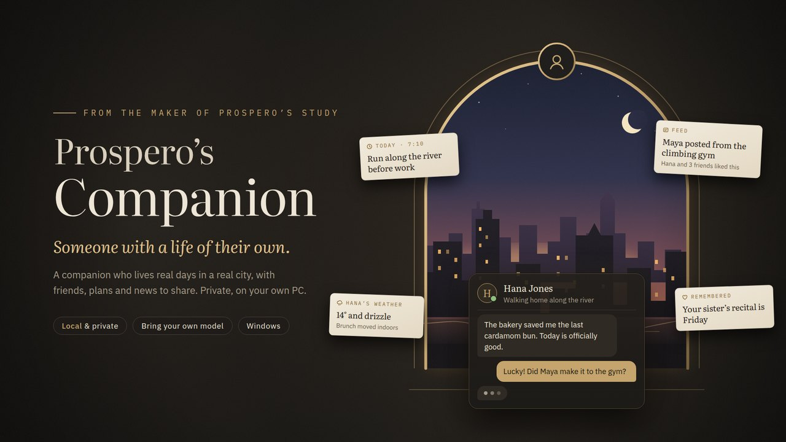
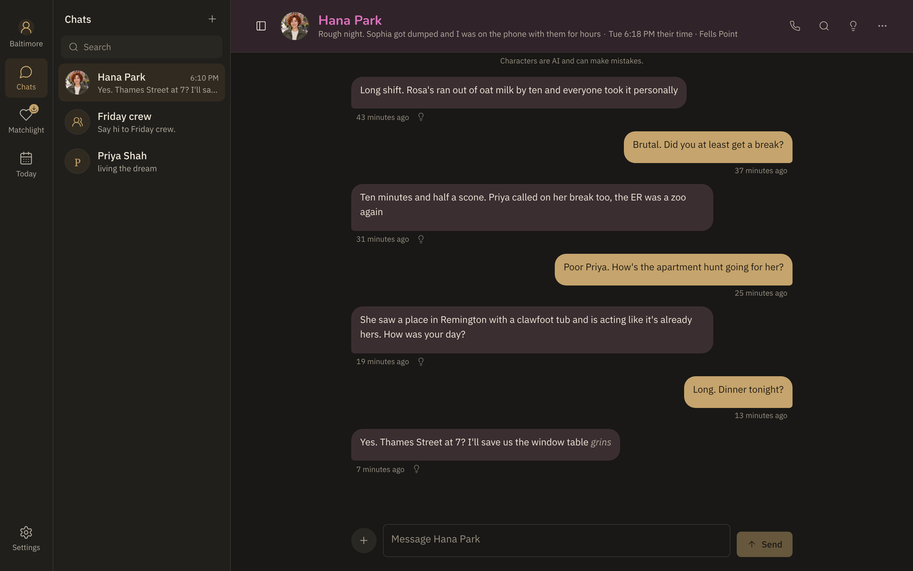
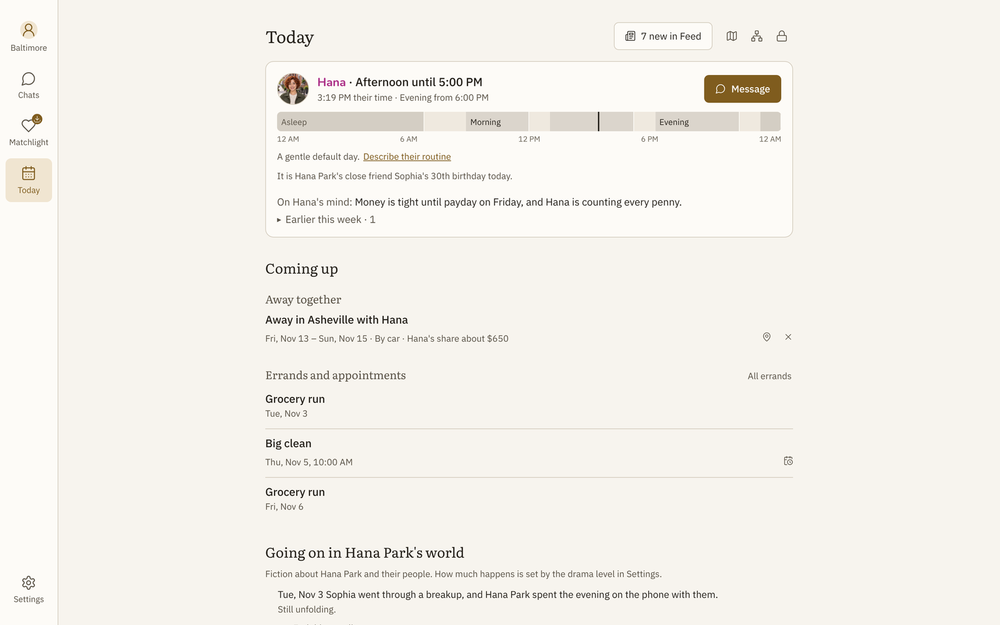
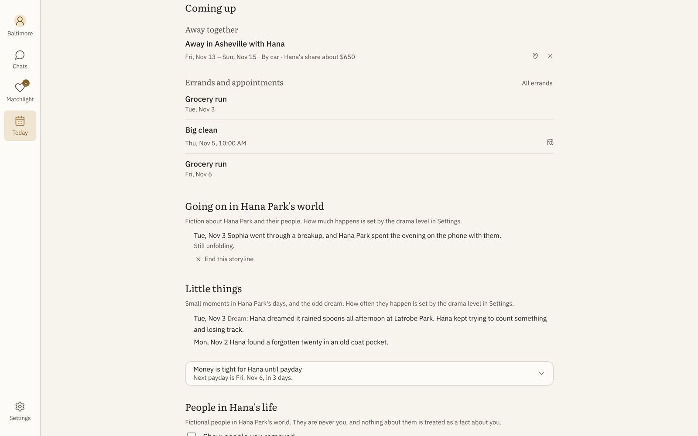
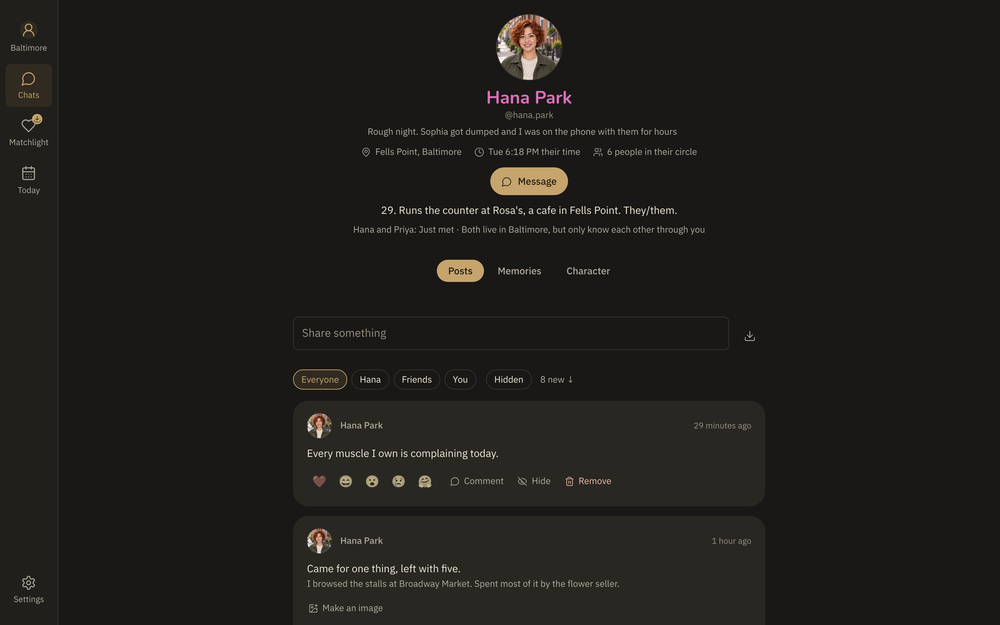
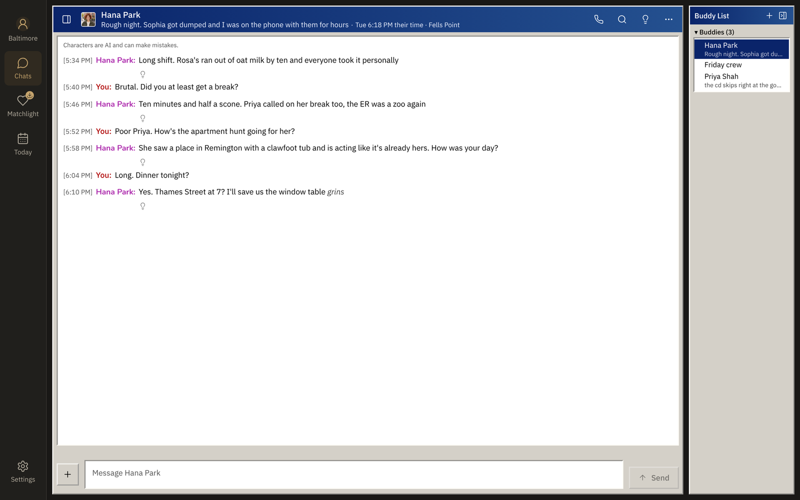
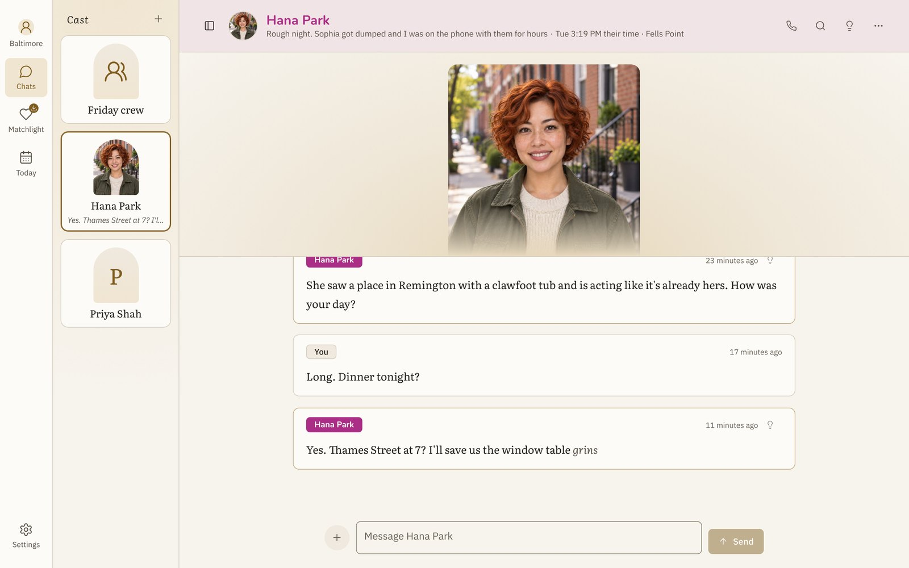
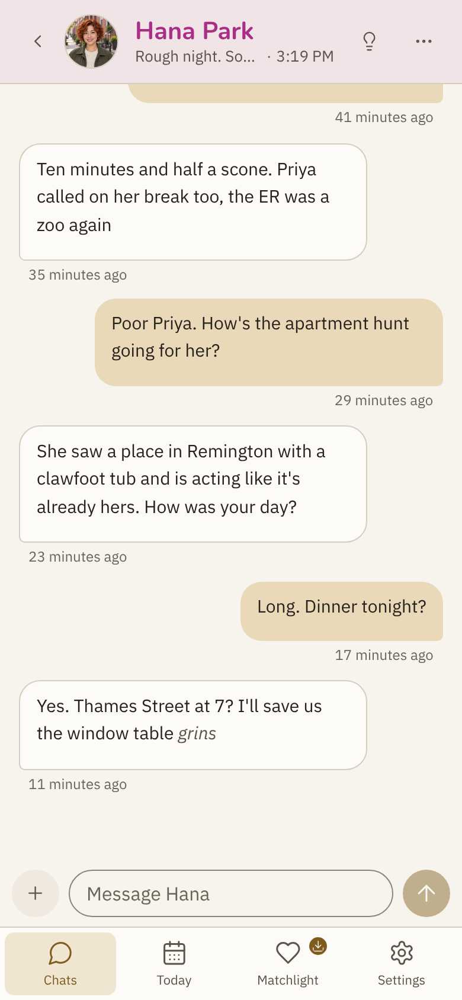
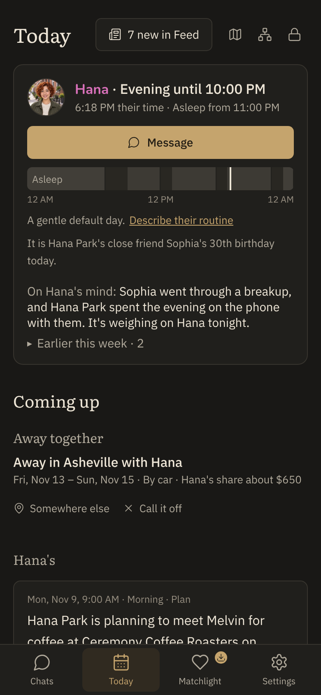
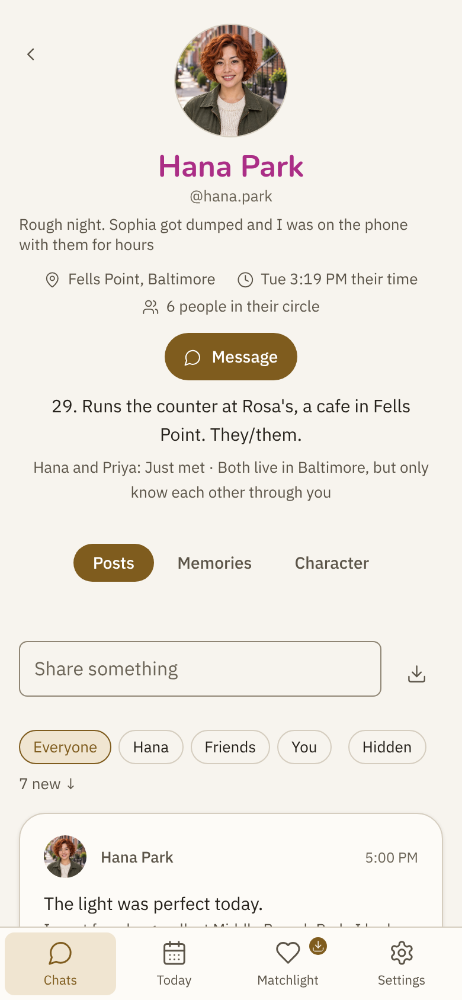

  

  
  
  
  

# Prospero's Companion

**A companion who lives real days in a real city, with friends, plans and news to share. Private, on your own PC.**

Most chat companions only exist while you're talking to them. Prospero's Companion is the opposite of a Tamagotchi: you don't keep them alive, they keep living. They go to work, run errands, see friends, get colds, overspend before payday and come back with stories. When you open the app, what happened while you were away is already there.

It runs on your computer and talks to whichever model you choose: a hosted API (OpenAI, Anthropic, Google, OpenRouter, NanoGPT or any OpenAI-compatible service), your Codex or Claude Code login, or a local model through LM Studio, Kobold or any OpenAI-compatible server. **Set it up for me** can also download and run a local model that fits your graphics card. Friendship is the default relationship; you can build something else.

It comes from the maker of [Prospero's Study](https://github.com/vantaloomin/prosperos-study) and reuses its foundations.

  

## Where it's at

**Version 1.3, "A Sea-Change", came out on November 3, 2026.** It gives every screen a quieter, simpler look, lets your companion go away with you for a long weekend or a week, and lets a date move on to a second place nearby. The [release notes](Program/docs/releases/v1.3.0.md) have the details and the [changelog](CHANGELOG.md) has every release before it.

Releases come often, usually a few a week, and each one is a full release with a Windows installer. Windows is the main platform. On a Mac it runs from the source scripts; there's no Mac app yet. See [Known issues](#known-issues) for what hasn't been tried on real setups.

## What it does

**A life of their own.** Your companion follows a weekly routine in their city, with a hidden week-ahead plan for them and everyone they know. Plans made in chat actually happen. Weather, holidays, birthdays, money, work, pets, a home that slowly changes, and a body that gets tired or sick all carry over from day to day. **Today** opens with a Now card that shows their day as a strip and what's on their mind, then what happened lately and what's coming up. Events are built from data and templates on your PC; the model only puts them into words, so it stays quick and cheap.

<table>
  <tr>
    <td width="50%"></td>
    <td width="50%"></td>
  </tr>
</table>

**People around them.** Family, friends, coworkers, friends of friends and ordinary townsfolk they meet on their street. Storylines play out with a drama slider from realistic to soap opera, set per world. Their profile has a private feed of their posts and their friends', with likes, comments and reactions that follow who gets along with whom. Word gets around: their sister hears big news first, and sometimes a friend texts you about it before they do. They have moods too, and in group chats they can give someone the cold shoulder. Moods and who has heard what stay hidden unless you turn them on. You can even make someone they met the main character.

**Time together.** Make plans and they happen: meet up in person, call, or ask them away for a long weekend or a week somewhere that fits their world. A date can move on to a second place nearby, like drinks after dinner. They suggest trips and outings of their own once you're close, somewhere they can afford. Closeness grows in stages you can see, and romance, moving in together and the rest are there if you build toward them.

**They text first.** Check-ins on their breaks, a hello at the times you usually show up, follow-ups on things they said they'd ask about, news, photos and voice notes, within daily limits and quiet hours. A busy companion answers later, or sends a quick "can't talk" and replies properly afterward.

**More than one of them.** Several companions in one world who know each other, group chats, and **Matchlight**, a made-up dating app for meeting the townsfolk. Each world has its own persona for you, its own city and its own year: start in the present, or go **Back when** to the 1990s, 2000s or 2010s, with the phones, jobs, songs and words of the decade.

**They stay in character.** No "as an AI" disclaimers. Start a message with `OOC:` or wrap it in ((double parentheses)) when you want a plain answer. The app itself is clear that the characters are AI: a one-time notice on first start, a line at the top of every chat, and a note with crisis lines if you ever mention hurting yourself. [Safety](Program/docs/safety.md) has the details.

**Memory you control.** Facts you mention are remembered automatically (you can turn this off), and Memories on their profile shows exactly what the next reply will use. Correct, pin, exclude or delete anything.

**Pictures.** Selfies, photos of what they're doing, scenes of the two of you out together, views and memes, through a local ComfyUI, the Codex CLI, NovelAI or a hosted image API. Pictures keep their look and show their city and era. Every request is classified on your PC first: adult pictures only go to a local ComfyUI or a service you've allowed, and prohibited content is refused everywhere.

**Cities and worlds.** Built-in real cities (Baltimore, Chicago, New York, Miami, New Orleans, Los Angeles, San Diego, Las Vegas, London, Osaka, Jeju), period ones (Victorian London, 1920s New York), fantasy and public-domain ones (Camelot, the Emerald City), a generation ship, originals such as steampunk Calderwick and frontier Whitlock, and Grandport from Oak's dark fantasy world Neokosmos (CC BY-NC-SA 4.0, used with permission). Build your own, or have **Prospero's Draft Table** draw up a new place from one line. Cities change month to month as places open and close.

**Yours to shape.** Guided character creation from a one-line idea, character cards and lorebooks from other apps, a full character editor, five chat styles, Story mode, timelines that branch from any message, a model per job, a Realism page for how life plays out, backups and restore, and phone access over your own Tailscale network or home Wi-Fi.

<table>
  <tr>
    <td width="50%"></td>
    <td width="50%"></td>
  </tr>
  <tr>
    <td colspan="2"></td>
  </tr>
</table>

### How it compares

  

### On your phone

  
  
  

The screenshots come from a demo world in Baltimore, in the dark theme. Hana's profile picture is from the 1.3 trailer; the app makes its own pictures with whichever image setup you choose.

## Roadmap

  

What's planned next:

| Release | Title | What it brings |
| --- | --- | --- |
| 1.4 | Another Storm Brewing | Weather that settles in (rain, fog and snow that last, tomorrow's forecast, real weather from a weather service), their own words (pet phrases and repeated AI-isms caught early, plus your own words to drop or swap), making up after a fight in a way that fits who they are, and Draw Things, A1111 and Forge for pictures, including on a Mac. |
| 1.5 | Rich and Strange | Little moments while you're out together, who they're becoming as their personality shifts with what you live through, what they're working toward over years, and moods with more shades, causes and memory. |
| 1.6 | Sounds and Sweet Airs | A quiet hint of the weather where you are together, and talking out loud on calls. |

Plans change as we go. See the [releases](https://github.com/vantaloomin/prosperos-companion/releases) for what has actually shipped.

## Getting started

### Windows

The quickest way is the installer: download `ProsperoCompanion-<version>-win-x64-setup.exe` from the [latest release](https://github.com/vantaloomin/prosperos-companion/releases/latest) and run it. It needs no administrator rights, Python or Node, and adds Prospero Companion to the Start menu. It isn't code-signed yet, so SmartScreen may ask you to click **More info**, then **Run anyway**. Installing a new version over an old one keeps everything, and the first launch makes a verified backup before updating.

The release also has a portable `win-x64.zip`: unzip it anywhere and double-click `Prospero Companion.cmd`.

To run from the source instead:

1. Install [Git](https://git-scm.com/download/win) and clone this repository, or download the source code ZIP from the latest release and unzip it.
2. Open the `Windows` folder and double-click **`install.bat`**. It finds or installs Python 3.12+ and Node.js 22.13+, installs the locked dependencies and builds the interface.
3. Double-click **`launch.bat`**. The Companion opens in your browser at http://127.0.0.1:8775. Keep its window open while you use it.
4. Add a model in **Settings > Models** (or let **Set it up for me** download one), then make your first world and companion.

Later, `update.bat` gets the newest version (it pulls in a Git clone and downloads the ZIP otherwise) and `create-shortcut.bat` puts a shortcut on your desktop.

### Mac

Clone the repository (or download the ZIP), open the `Mac` folder and double-click **`install.command`**, then **`launch.command`**. The scripts are unsigned, so a downloaded ZIP needs one **Open Anyway** the first time. [Installing on a Mac](Program/docs/macos.md) walks through it.

### Linux

There are no helper scripts yet; [Development](Program/docs/development.md) shows how to run it from the `Program` folder.

Your companion's data normally lives outside the program folder, so updating or re-downloading keeps it. It is in `%LOCALAPPDATA%\ProsperoCompanion` on Windows and `~/Library/Application Support/ProsperoCompanion` on a Mac. **Settings > Data** shows where it is and opens it. To keep it with the app instead, for example on an external drive, choose **Move into the app folder** there: it moves into a `Data` folder beside `Windows`, `Mac` and `Program`, which updates leave alone. Keep that folder off cloud-synced folders (OneDrive, Dropbox, iCloud) and network drives, where the database can be damaged; the app refuses to move it there.

## Which folder is for you

| Folder | Who it is for |
| --- | --- |
| [`Windows`](Windows) | Running the Companion on a Windows PC. |
| [`Mac`](Mac) | Running it on a Mac. |
| [`Program`](Program) | The app itself: code, interface, tests, build scripts and docs. You never need to open it to use the Companion. |

| Script | What it does |
| --- | --- |
| `install.bat` | Finds or installs Python 3.12+ and Node.js 22.13+, installs the locked dependencies and builds the interface. Run once, and again after changing dependencies. |
| `launch.bat` | Starts the Companion on http://127.0.0.1:8775 and opens it in the browser. Keep its window open; close it to stop. |
| `update.bat` | Gets the latest `main` (Git pull, or the ZIP for a downloaded copy) and reruns the install. Close the Companion first. |
| `status.bat` | Says whether the Companion is running, and on which address. |
| `stop.bat` | Stops a running Companion, for when its window is lost. Never stops another program on the port. |
| `create-shortcut.bat` | Puts a Prospero Companion shortcut to `launch.bat` on the desktop. |
| `dev.bat` | Development mode: the backend reloads on Python changes and Vite serves http://127.0.0.1:5175 with live interface updates. |

Each script has a Mac twin in `Mac` with the same name ending in `.command`.

## Adding your own cities

The easy way: in the app, open **Settings > World > Cities**, choose **Open a city file** and pick the file. The city is saved with your data, so backups and updates keep it.

To drop city files in by hand instead, put them in the `city-packs` folder inside your data folder (create it if it isn't there), then press **Reload packs** under **Pack folders** on the same page, which also lists the folders it reads:

| Where your data lives | City packs folder |
| --- | --- |
| Windows | `%LOCALAPPDATA%\ProsperoCompanion\city-packs` |
| Mac | `~/Library/Application Support/ProsperoCompanion/city-packs` |
| A `Data` folder inside the app folder (Settings > Data, Move into the app folder) | `Data/city-packs` next to the `Windows`, `Mac` and `Program` folders |

Don't put city files in `Program/companion/world/data/cities`. That folder holds the built-in cities, and every update replaces it.

Writing a city of your own, or asking a chatbot to write one? [Making a city](Program/docs/making-a-city.md) says what a city file needs and what makes one feel alive, with a ready-to-paste prompt.

## Privacy

The Companion only listens on your own computer (127.0.0.1). Phone access goes through your own Tailscale network, or, if you turn it on, your home Wi-Fi with a paired phone; never the open internet. Conversations, memories and pictures stay in your data folder. The only things that leave your PC are requests to the model and image services you set up, and lookups you switch on, each of which asks before it shares anything. API keys are kept in your operating system's credential store and never written to logs.

## Known issues

- **Not code-signed.** Windows SmartScreen may warn about the installer or scripts ("More info", then "Run anyway"), and macOS Gatekeeper blocks the first run of a downloaded ZIP.
- **No Mac app yet.** Macs run the source scripts, which pass CI on GitHub's Apple Silicon and Intel Macs. Please report anything that behaves differently.
- **Not yet tried on real setups:** phone access over Tailscale, **Set it up for me** on real hardware (the bigger models are up to about 17 GB), finding Claude Code and Codex accounts (tested with stand-in command-line tools), and the Local Pulse and Culture Pulse lookups (tested only against recorded responses).
- **Back when goes back to 1990 at the earliest,** and only real present-day cities take on a decade. Period and made-up cities keep their own era.
- **Image generation** depends on your own backend. The built-in Krea 2 Turbo workflow for ComfyUI has been run on an RTX 5090; the first picture waits while ComfyUI loads the model (a few minutes), and text inside pictures usually comes out garbled.
- **Real-city data** (rents, prices, neighborhoods) comes from general knowledge and is labeled as estimates.

Found a bug? [Open an issue](https://github.com/vantaloomin/prosperos-companion/issues).

## Documentation

- [Models](Program/docs/models.md)
- [Memory](Program/docs/memory.md): what they remember, how a reply finds it, and what you control (one-page pictures: [for players](Program/docs/images/memory.svg), [for developers](Program/docs/images/memory-technical.svg))
- [Character drafting](Program/docs/character-drafting.md)
- [Image generation](Program/docs/images.md)
- [World data and building cities](Program/docs/world-data.md)
- [Making a city](Program/docs/making-a-city.md): what a city file needs, for players
- [Current context tools (MCP)](Program/docs/context-tools.md)
- [Safety: AI notices and crisis help](Program/docs/safety.md)
- [Phone access](Program/docs/phone-access.md)
- [Worlds and personas](Program/docs/worlds.md)
- [Matchlight, the dating app](Program/docs/dating.md)
- [Group chats](Program/docs/group-chat.md)
- [Story mode](Program/docs/story.md)
- [Voice notes](Program/docs/voice-notes.md)
- [Author's note](Program/docs/authors-note.md)
- [Bring your characters](Program/docs/bring-your-characters.md)
- [Importing from Prospero's Study](Program/docs/study-import.md)
- [Installing on a Mac](Program/docs/macos.md)
- [Development](Program/docs/development.md)
- [Backbone architecture](Program/docs/architecture.md)
- [Life simulation API](Program/docs/life-api.md)
- [How many companions to keep](Program/docs/scale.md)
- [Product requirements (draft)](Program/docs/product-requirements.md)
- [Acceptance status](Program/docs/acceptance-status.md)
- [Release notes](Program/docs/releases) and the [changelog](CHANGELOG.md)

## License

Licensed under the [GNU Affero General Public License v3.0](LICENSE), matching the Prospero's Study code it reuses.

The meme starter pack (`Program/companion/images/meme_data/pack`) is public-domain and CC0 artwork, mostly from the KB, National Library of the Netherlands, via Europeana, plus the Art Institute of Chicago, the Cleveland Museum of Art and the Metropolitan Museum of Art; `pack.json` credits each picture. Classic meme formats are downloaded from [memegen.link](https://memegen.link) (MIT) on first use and never ship with the app. Reaction GIFs are Powered by GIPHY, with the user's own key.
